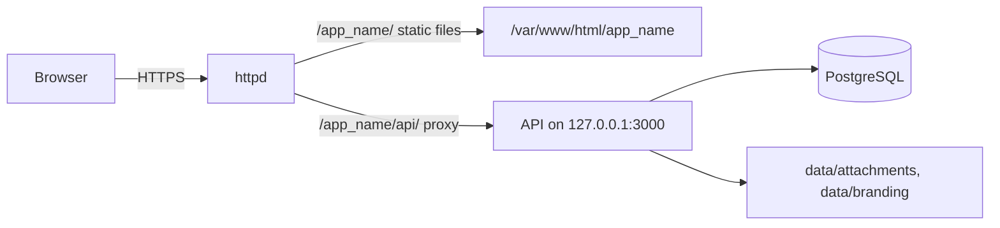

# Architecture

Kloister is one Node.js backend, one Angular single-page app and one PostgreSQL database, served
behind an existing httpd on a single host. This document describes how the code is organised and
how it runs. The summary and diagrams are in [README.md](README.md).

## Repository layout

npm workspaces, one lockfile:

| Path                 | Contents                                                                                                                |
| -------------------- | ----------------------------------------------------------------------------------------------------------------------- |
| `apps/api/`          | Backend: NestJS on the Fastify adapter, Prisma, TypeScript strict                                                       |
| `apps/web/`          | Web app: Angular (standalone components, signals), Angular Material and CDK                                             |
| `packages/shared/`   | Types and pure logic used by both: DTOs, enums, permission table, scheduling, live event names                          |
| `deploy/`            | RHEL install, upgrade and service scripts, the httpd template, packaging and documentation generators, deployment tests |
| `docs/`              | Operator guides, design, decisions, milestone plans, `openapi.json` and these technical documents                       |
| `.github/workflows/` | `ci.yml` (every push and pull request) and `release.yml` (version tags)                                                 |
| `SPEC.md`            | The product specification; the source of truth for behaviour                                                            |

`packages/shared` is compiled first (`packages/shared/dist`) and imported as `@kloister/shared` by
both apps. Keeping DTOs, permission names and the planner there means the API and the web app
cannot disagree about a shape or a rule.

## Backend

### Process

`apps/api/src/main.ts` builds the app with `createApp()` from `app.factory.ts` and listens on
`BACKEND_HOST:BACKEND_PORT` (default `127.0.0.1:3000`). Only httpd on the same host talks to it.
`configureApp()` applies the global setup that tests share:

- the cookie plugin;
- a content-type parser that hands raw upload bodies (`application/octet-stream`) to the route
  unread, so guards run before any byte is read and files stream to disk;
- the route prefix `api/v1`;
- `AllExceptionsFilter`, which turns every error into the `{ code, message, details? }` shape and
  logs 5xx errors without sending their details;
- a pipe that lowercases uuid path parameters, then the validation pipe (class-validator DTOs;
  unknown fields are rejected).

Fastify's default JSON body limit (1 MiB) applies except on the two ADO routes that carry a CSV,
which allow 24 MiB.

### Modules

Each folder under `apps/api/src/` is one area. Modules are wired in `app.module.ts`.

| Folder           | Responsibility                                                                                                                                                                                                     |
| ---------------- | ------------------------------------------------------------------------------------------------------------------------------------------------------------------------------------------------------------------ |
| `auth/`          | Sign-in, sign-out, password change; the global CSRF and session guards; login rate limit; password hashing; sessions; the `@Public`, `@AdminOnly`, `@AllowPendingPasswordChange` and `@KeepSessionIdle` decorators |
| `users/`         | The caller's account (`me`), the first-login introduction state and user administration                                                                                                                            |
| `audit/`         | `AuditService.record()` (the audited write that also publishes live updates), visit-based recording and the admin viewer                                                                                           |
| `projects/`      | Projects, members, teams, personal spaces, project settings, `ProjectAccessGuard` and `ProjectAccessService` (all permission and visibility rules)                                                                 |
| `board/`         | Buckets and their status rules, labels, sprints                                                                                                                                                                    |
| `items/`         | Work items, hierarchy, dependencies, checklists, duplication, My work and "all their work", Excel and offline snapshots                                                                                            |
| `timeline/`      | The timeline's visible links and rescheduling with dependent moves                                                                                                                                                 |
| `holidays/`      | Instance and project holidays and each project's working-day calendar                                                                                                                                              |
| `annotations/`   | Notes, attachments, inline images and the nightly clean-up of unused images                                                                                                                                        |
| `storage/`       | The file store under `ATTACHMENTS_DIR` and file-type detection from content                                                                                                                                        |
| `notifications/` | In-app notifications, mention and assignment notices, the 09:00 due-date job                                                                                                                                       |
| `live/`          | Live updates: the event stream, presence, the PostgreSQL listener and the event mapping                                                                                                                            |
| `settings/`      | `SettingsService` (every `AppSetting` key), admin settings routes, disk usage                                                                                                                                      |
| `branding/`      | Public branding (app name, logo, fonts, default theme) and its admin routes                                                                                                                                        |
| `backups/`       | Scheduled and manual `pg_dump` backups with retention                                                                                                                                                              |
| `logging/`       | pino loggers writing daily files and the log retention job                                                                                                                                                         |
| `ado/`           | The offline ADO CSV transfer (see [ADO-TRANSFER.md](ADO-TRANSFER.md))                                                                                                                                              |
| `health/`        | `GET /api/v1/health` for scripts                                                                                                                                                                                   |
| `config/`        | `AppConfig`: environment variables, validated at startup                                                                                                                                                           |
| `prisma/`        | `PrismaService` (the Prisma client on the `pg` driver adapter)                                                                                                                                                     |
| `common/`        | Shared helpers: error types, pagination, dates, fractional positions, HTML sanitizing, serializable transactions, validation                                                                                       |
| `cli/`           | `create-admin` (first administrator) and the build-time OpenAPI generator                                                                                                                                          |
| `generated/`     | The Prisma client, generated by `npm run generate` (not committed)                                                                                                                                                 |

Controllers are thin: they declare the route, its guard metadata and its DTOs, and call a service.
Services do the work inside transactions. Every exported symbol has a doc comment stating its
purpose and permission implications; the [API reference](API.md) is built from them.

### Requests and authorization

A request passes, in order: the CSRF guard, the session guard (session, pending password change,
`@AdminOnly`), route guards (`ProjectAccessGuard` on project routes, the login rate limit on
sign-in), validation, the controller and the service. The service applies the item-level rules
and the visibility filter. [SECURITY.md](SECURITY.md) has the details.

### Transactions and consistency

Changes run in Prisma transactions. Changes whose checks depend on other rows (hierarchy, cycles,
the last PM, reschedules) use `serializable()` from `common/transactions.ts`, which runs the work at
serializable isolation. A concurrent change that would break a check makes one transaction fail,
and that failure (like a unique or foreign-key violation) answers 409 `CONFLICT` ("try again"). Item and bucket order use fractional
positions (`common/positions.ts`), so a move rewrites one row.

### Configuration

`AppConfig` (`config/app-config.ts`) reads the environment once at startup and refuses to start on
invalid values. On a server the install script writes them to `config/kloister.env`. The defaults
in the last column are development fallbacks; with `NODE_ENV=production` the folder variables,
`PG_DUMP_PATH` and `APP_NAME` must be set. `pg_dump` also reads `PGPASSFILE` when it is set.

| Variable                    | Meaning                                                                          | Default                               |
| --------------------------- | -------------------------------------------------------------------------------- | ------------------------------------- |
| `DATABASE_URL`              | PostgreSQL connection string                                                     | required                              |
| `NODE_ENV`                  | `production` makes `APP_NAME` and every folder and `PG_DUMP_PATH` below required | none                                  |
| `APP_NAME`                  | Path segment the app is served under; sets the cookie path `/<APP_NAME>/`        | empty (cookie path `/`)               |
| `BACKEND_HOST`              | Listen address                                                                   | `127.0.0.1`                           |
| `BACKEND_PORT`              | Listen port                                                                      | `3000`                                |
| `TRUST_PROXY`               | Addresses allowed to set `X-Forwarded-For`; `false` to trust none                | `loopback`                            |
| `ATTACHMENTS_DIR`           | Absolute folder for uploaded files                                               | a temporary folder (development only) |
| `BRANDING_DIR`              | Absolute folder for the logo and font files                                      | a temporary folder                    |
| `BACKUP_DIR`                | Absolute folder for database dumps                                               | a temporary folder                    |
| `APP_DIR`                   | The app's root folder, for the disk usage page                                   | the working folder                    |
| `PG_DUMP_PATH`              | `pg_dump` binary matching the server's major version                             | `pg_dump` on `PATH`                   |
| `LOG_DIR`                   | Folder for daily log files; unset (development only) logs to standard output     | unset                                 |
| `LOG_LEVEL`                 | pino level                                                                       | `info`                                |
| `LOGIN_RATE_LIMIT`          | Sign-in attempts per client address per window                                   | `10`                                  |
| `LOGIN_RATE_WINDOW_SECONDS` | The window                                                                       | `60`                                  |

Everything an administrator can change at runtime (timeouts, lockout, file limits, quotas, log and
backup retention, theme, branding, live updates) is an `AppSetting`, described in
[DATA-MODEL.md](DATA-MODEL.md#appsetting).

### Files on disk

| Location                                       | Contents                                                |
| ---------------------------------------------- | ------------------------------------------------------- |
| `ATTACHMENTS_DIR/<projectId>/<uuid>`           | Attachments and inline images (random names)            |
| `ATTACHMENTS_DIR/.incoming/`                   | Uploads in progress; abandoned ones are removed nightly |
| `BRANDING_DIR/`                                | The uploaded logo and font files                        |
| `BACKUP_DIR/<app_name>-<yyyymmdd-hhmmss>.dump` | Database dumps (`pg_dump -Fc`)                          |
| `LOG_DIR/backend/backend-<yyyy-mm-dd>.log`     | Backend log (JSON lines)                                |
| `LOG_DIR/backups/backup-<yyyy-mm-dd>.log`      | Backup log                                              |

The server layout around these folders is in SPEC §9.1 and [INSTALL.md](../INSTALL.md).

### Logging

`logging/` provides two pino loggers writing JSON lines to daily files: the backend log (Nest's own
messages are routed into it too) and the backup log. Requests are not logged one by one (httpd
keeps the access log), and passwords, tokens and cookies are never logged. In development, without
`LOG_DIR`, the backend logs to standard output.

### Scheduled jobs

`@nestjs/schedule` runs these in the API process, using the server's local time:

| Schedule     | Job                                                | Code                                  |
| ------------ | -------------------------------------------------- | ------------------------------------- |
| every minute | Starts the daily backup when its time comes        | `backups/backups.service.ts` (`tick`) |
| 03:30 daily  | Removes unused inline images and abandoned uploads | `annotations/annotation-jobs.ts`      |
| 03:45 daily  | Deletes log files older than the retention         | `logging/log-retention.job.ts`        |
| 04:15 daily  | Expires old ADO transfer content and previews      | `ado/ado.service.ts` (`cleanup`)      |
| 09:00 daily  | Due-tomorrow and overdue notifications             | `notifications/notification-jobs.ts`  |

### Backups

`backups/` runs `pg_dump -Fc` with the backend's database credentials (from the environment or the
`.pgpass` file named by `PGPASSFILE`; nothing else of the backend's environment is passed on) into
`BACKUP_DIR`, daily at the admin's time and on demand ("Run now"). Dumps older than the retention
are deleted after a successful run. Each outcome is audited and written to the backup log. Backups
cover the database only; the guides explain how to back up files and configuration.

## Web app

The Angular app is described in [WEB.md](WEB.md). It calls the API with relative URLs built from
the document's base href, so it works under any path.

## Serving under a path

On a server, httpd serves the built web app from `/var/www/html/<app_name>/` with a fallback to
`index.html` for client-side routes, and proxies `/<app_name>/api/` to the backend on loopback. The
Angular build uses the base href `/__KLOISTER_BASE__/`, which the install script replaces with
`/<app_name>/`. The session cookie is scoped to the same path through `APP_NAME`. In development,
`ng serve` proxies `/api` to `127.0.0.1:3000` (`apps/web/proxy.conf.json`).

The live-update stream uses the same proxy; [LIVE-UPDATES.md](LIVE-UPDATES.md) covers the
optional httpd line for proxies that buffer it.

## Build and packaging

- `npm run build` builds `packages/shared`, then the API (`prisma generate`, `nest build`, then
  `node dist/cli/openapi.js`, which writes `apps/api/dist/openapi.json`), then the web app.
- The API build uses the `@nestjs/swagger` compiler plugin, which reads DTO classes and controller
  doc comments. The generator adds what decorators cannot express by reading the controllers'
  declared return types with the TypeScript compiler (`cli/openapi-types.ts`), and the guards'
  metadata for permissions. `npm run docs` copies the document to `docs/openapi.json` and renders
  [API.md](API.md) (`deploy/api-reference.mjs`) and the schema diagram (`deploy/schema-diagram.mjs`);
  deployment tests fail when any of them is stale.
- `npm run package:release -- <version> <folder>` (`deploy/package.mjs`) builds the release ZIP:
  `backend/` (compiled API without the documentation generator, Prisma schema and migrations, a
  production `package.json` and lockfile, `@kloister/shared` vendored as a file dependency),
  `frontend/` (the Angular build), `deploy/` and `docs/`. `deploy/verify-package.mjs` extracts and
  checks it.
- `release.yml` runs only on `v*` tags: it builds, packages and verifies the ZIP and keeps it as a
  workflow artifact. Publishing a release from it is a separate manual step.
- On the server, `deploy/install.sh` and `deploy/upgrade.sh` install the backend with
  `npm ci --omit=dev`, apply migrations and run the backend as its own system user with an
  app-local Node runtime. They never change firewall, SELinux or httpd configuration beyond the one
  Kloister conf file. See [INSTALL.md](../INSTALL.md) and [UPGRADE.md](../UPGRADE.md).
