# Data model

Kloister keeps everything in one PostgreSQL database, defined in
[`apps/api/prisma/schema.prisma`](../../apps/api/prisma/schema.prisma) and accessed through
Prisma. Uploaded files live on disk (see [ARCHITECTURE.md](ARCHITECTURE.md#files-on-disk)); the
database holds their metadata.

General rules:

- Every table has a uuid `id`. Most also have `createdAt` and `updatedAt`; `AuditLog` and `Holiday`
  have only `createdAt` (audit entries are never updated, holidays are removed by setting
  `deletedAt`).
- Calendar dates (`startDate`, `dueDate`, sprint and holiday dates) are PostgreSQL `date` columns
  and travel through the API as `YYYY-MM-DD`. Timestamps are `timestamp(3)` in UTC.
- Composite foreign keys keep related rows in one project: a `WorkItem`'s parent and bucket, its
  labels and assignees, `TeamMember` rows and dependency links all reference `(id, projectId)`.
  The database therefore refuses, for example, a parent from another project.
- Rules that need more than a key (no dependency cycles, the hierarchy rules, at most one active
  sprint per project, the last PM) are checked in code inside serializable transactions
  (`apps/api/src/common/transactions.ts`).

## Diagram

The diagram is generated from `schema.prisma` by `deploy/schema-diagram.mjs`; a deployment test
fails when it is stale. It shows key columns only (PK primary key, FK foreign key, UK unique); the
sections below describe the other columns.

```mermaid
erDiagram
  User {
    uuid id PK
    string email UK
  }
  Session {
    uuid id PK
    uuid userId FK
    string tokenHash UK
  }
  AuditLog {
    uuid id PK
    uuid actorId FK
  }
  AppSetting {
    uuid id PK
    string key UK
  }
  Project {
    uuid id PK
    string key UK
    uuid ownerId FK, UK
  }
  AdoDestination {
    uuid id PK
    uuid projectId FK, UK
  }
  AdoItemLink {
    uuid id PK
    uuid destinationId FK
    uuid projectId FK
    string reference UK
  }
  AdoTransferBatch {
    uuid id PK
    uuid destinationId FK
    uuid projectId FK
  }
  AdoTransferRow {
    uuid id PK
    uuid batchId FK
    uuid projectId FK
  }
  ProjectMember {
    uuid id PK
    uuid projectId FK
    uuid userId FK
  }
  Team {
    uuid id PK
    uuid projectId FK
  }
  TeamMember {
    uuid id PK
    uuid teamId FK
    uuid projectId FK
    uuid userId FK
  }
  Bucket {
    uuid id PK
    uuid projectId FK
  }
  Sprint {
    uuid id PK
    uuid projectId FK
  }
  Label {
    uuid id PK
    uuid projectId FK
  }
  WorkItem {
    uuid id PK
    uuid projectId FK
    uuid parentId FK
    uuid bucketId FK
    uuid sprintId FK
    uuid teamId FK
    uuid createdById FK
    uuid deletedById FK
  }
  ItemReference {
    uuid id PK
    uuid sourceItemId FK
    uuid targetItemId FK
  }
  WorkItemAssignee {
    uuid id PK
    uuid workItemId FK
    uuid projectId FK
    uuid userId FK
  }
  WorkItemDependency {
    uuid id PK
    uuid projectId FK
    uuid blockedItemId FK
    uuid blockingItemId FK
  }
  WorkItemLabel {
    uuid id PK
    uuid workItemId FK
    uuid projectId FK
    uuid labelId FK
  }
  ChecklistItem {
    uuid id PK
    uuid workItemId FK
  }
  Note {
    uuid id PK
    uuid workItemId FK
    uuid authorId FK
  }
  Attachment {
    uuid id PK
    uuid workItemId FK
    uuid uploaderId FK
    string storedName UK
  }
  Notification {
    uuid id PK
    uuid userId FK
    uuid workItemId FK
    uuid actorId FK
  }
  Holiday {
    uuid id PK
    uuid projectId FK
    uuid createdById FK
  }
  User ||--o{ Session : "user"
  User |o--o{ AuditLog : "actor"
  User |o--o| Project : "owner"
  Project ||--o| AdoDestination : "project"
  AdoDestination ||--o{ AdoItemLink : "destination"
  AdoDestination ||--o{ AdoTransferBatch : "destination"
  AdoTransferBatch ||--o{ AdoTransferRow : "batch"
  Project ||--o{ ProjectMember : "project"
  User ||--o{ ProjectMember : "user"
  Project ||--o{ Team : "project"
  Team ||--o{ TeamMember : "team"
  ProjectMember ||--o{ TeamMember : "projectMember"
  Project ||--o{ Bucket : "project"
  Project ||--o{ Sprint : "project"
  Project ||--o{ Label : "project"
  Project ||--o{ WorkItem : "project"
  WorkItem |o--o{ WorkItem : "parent"
  Bucket |o--o{ WorkItem : "bucket"
  Sprint |o--o{ WorkItem : "sprint"
  Team |o--o{ WorkItem : "team"
  User ||--o{ WorkItem : "createdBy"
  User |o--o{ WorkItem : "deletedBy"
  WorkItem ||--o{ ItemReference : "source"
  WorkItem ||--o{ ItemReference : "target"
  WorkItem ||--o{ WorkItemAssignee : "workItem"
  ProjectMember ||--o{ WorkItemAssignee : "projectMember"
  WorkItem ||--o{ WorkItemDependency : "blockedItem"
  WorkItem ||--o{ WorkItemDependency : "blockingItem"
  WorkItem ||--o{ WorkItemLabel : "workItem"
  Label ||--o{ WorkItemLabel : "label"
  WorkItem ||--o{ ChecklistItem : "workItem"
  WorkItem ||--o{ Note : "workItem"
  User ||--o{ Note : "author"
  WorkItem ||--o{ Attachment : "workItem"
  User ||--o{ Attachment : "uploader"
  User ||--o{ Notification : "user"
  WorkItem ||--o{ Notification : "workItem"
  User |o--o{ Notification : "actor"
  Project |o--o{ Holiday : "project"
  User ||--o{ Holiday : "createdBy"
```

<!-- schema-diagram:start (generated by deploy/schema-diagram.mjs) -->



<!-- schema-diagram:end -->

## Accounts and sessions

### `User`

A local account. Accounts are created by administrators only (there is no self sign-up) and are
deactivated, never deleted, so their history stays readable.

- `email` is unique and stored lowercased, so sign-in is case-insensitive.
- `passwordHash` is an argon2id hash; it never leaves the API.
- `systemRole` (`SystemRole`: `ADMIN` or `USER`).
- `mustChangePassword` is set when an administrator creates the account or resets its password.
- `introductionState` (`IntroductionState`) drives the first-login tour: new accounts start at
  `AWAITING_INITIAL_PASSWORD`, become `READY` after the first password change and `DISMISSED` once
  the tour is finished or skipped; accounts from before the tour are `EXEMPT`. Password resets keep
  the state.
- `isActive`, `failedLoginCount` and `lockedUntil` implement deactivation and lockout.
- `themePrefs` (JSON) holds the personal theme; empty means "use the default".
- `lastLoginAt`.

### `Session`

A server-side session. The cookie carries a random token; only its SHA-256 hash is stored
(`tokenHash`, unique), so a database copy does not contain usable sessions. `expiresAt` is the
absolute expiry fixed at sign-in; `lastSeenAt` drives the idle timeout. `userAgent` and `ip` are
kept for the record. Sessions are deleted with their user (cascade).

## Audit and settings

### `AuditLog`

Append-only record of every change and every security-relevant event: `actorId` (null for failed
sign-ins and the CLI bootstrap), `action` (an `AuditAction` name from
`packages/shared/src/audit.ts`), `entityType`, `entityId`, `projectId` for project-scoped actions,
and `meta` (JSON with the details, for example the changed fields). Indexes serve the admin viewer
(`createdAt, id`), an item's activity history (`entityType, entityId`), a project's entries and
finding an administrator's current cross-project visit (`actorId, action, projectId, createdAt`).
The audited write is also where live updates start (see [LIVE-UPDATES.md](LIVE-UPDATES.md)).

### `AppSetting`

Admin-editable settings, one JSON `value` per unique `key`. Each reader takes every field over a
built-in default, so a missing or malformed key never breaks the app:

| Key             | Contents                                                                             | Default                           |
| --------------- | ------------------------------------------------------------------------------------ | --------------------------------- |
| `security`      | `idleTimeoutMinutes`, `absoluteTimeoutMinutes`, `lockoutThreshold`, `lockoutMinutes` | 480, 10080, 5, 15                 |
| `storage`       | `maxFileSizeMb`, `projectQuotaMb`, `personalQuotaMb`, `trashRetentionDays`           | 25, 2048, 1024, 30                |
| `logs`          | `retentionDays`                                                                      | 30                                |
| `backups`       | `enabled`, `time` (`HH:MM` server time), `retentionDays`                             | on, `02:00`, 14                   |
| `live`          | `enabled` (live updates)                                                             | on                                |
| `theme`         | The default theme: `mode`, `primary`, `accent`                                       | system mode, `#4F46E5`, `#4F46E5` |
| `branding`      | `appName`, `font`                                                                    | `Kloister`, `FIGTREE`             |
| `brandingFiles` | Metadata of the uploaded logo and font files                                         | none                              |

The keys and defaults are in `apps/api/src/settings/settings.service.ts`.

## Projects, members and teams

### `Project`

An ordinary project (created by an administrator) or a personal space.

- `key`: 2–6 uppercase letters, unique, used in item keys like `KLO-42`; null for personal spaces,
  whose items show as `#42`.
- `ownerId`: set only for a personal space (unique: one per user). Ownership is independent of
  membership; personal spaces have no `ProjectMember` rows.
- `name`, `description`, `archivedAt` (archived projects are read-only).
- `lastItemNumber`: the last number handed out. Numbers are never reused, so a key always means the
  same item.
- `settings`: JSON, read by `parseProjectSettings` in `apps/api/src/projects/project-settings.ts`.
  Missing or malformed keys read as the defaults below, so a bad value can never grant a
  permission; writes merge into the stored JSON and keep keys a version does not know.

| Setting                  | Meaning                                                    | Default when missing                      |
| ------------------------ | ---------------------------------------------------------- | ----------------------------------------- |
| `membersCanAssignOthers` | Members may assign items to other people                   | off                                       |
| `statusToBucket`         | Map of status to bucket id: a status change moves the card | empty                                     |
| `labelStyle`             | `SOLID`, `TINTED` or `COVER`                               | `SOLID`                                   |
| `autoMoveDependents`     | Timeline date changes move dependent items without asking  | off (new projects are created with it on) |
| `useInstanceHolidays`    | The timeline also uses the instance-wide holidays          | on                                        |
| `holidaysReviewedAt`     | When PMs or Leads last reviewed instance holiday changes   | null                                      |
| `planLeadsOnly`          | Only PMs and Leads change the plan of existing items       | on                                        |

### `ProjectMember`

A user's membership: `role` (`ProjectRole`: `PM`, `LEAD`, `MEMBER`, `VIEWER`), `visibility`
(`Visibility`: `ALL`, `BUCKETS`, `OWN`, `TEAMS`) and `allowedBucketIds` for the `BUCKETS` scope.
Unique per `(projectId, userId)`. Removing a membership cascades to the user's team places and
assignments in that project. The rule that a project keeps at least one active PM is checked in
code. See [SECURITY.md](SECURITY.md) for what roles and scopes allow.

### `Team` and `TeamMember`

Optional teams inside a project: `Team` has a `name` (unique per project) and `description`.
`TeamMember` gives a project member a `role` in a team (`TeamRole`: `LEAD` or `MEMBER`), unique per
`(teamId, userId)`. Its composite keys reference both `Team(id, projectId)` and
`ProjectMember(projectId, userId)`, so only members of the team's own project can join and leaving
the project removes the user from its teams.

## Board

### `Bucket`

A board column: `name`, `position` (a fractional index, so a move rewrites one row), and the rule
applied when a card enters it: `onEnterMode` (`BucketRule`: `NONE`, `SET`, `SET_IF_NOT_STARTED`)
with `onEnterStatus`. New projects get Backlog, To Do, In Progress and Done. Deleting a bucket that still
holds items needs a destination bucket (`moveItemsTo`), which receives them in their order; without
one the API answers 409 `BUCKET_NOT_EMPTY`. The last bucket of a project cannot be deleted.

### `Sprint`

`name`, `startDate`, `endDate`, `state` (`SprintState`: `PLANNED`, `ACTIVE`, `CLOSED`; at most one
`ACTIVE` per project, checked in code) and `adoIterationPath`, an optional override for ADO export.
Deleting a sprint clears it from its items.

### `Label`

`name` (unique per project) and `colour` (`#rrggbb`). `WorkItemLabel` joins labels and items of
the same project.

## Work items

### `WorkItem`

- `number`: per-project sequence from `Project.lastItemNumber`, unique per project.
- `type` (`ItemType`: `EPIC`, `FEATURE`, `STORY`, `TASK`, `BUG`) and `parentId`. Allowed parents:
  Feature under Epic; Story under Feature; Task and Bug under Story or Feature. The rules and the
  absence of cycles are checked in code (`apps/api/src/items/hierarchy.ts`); the composite key keeps
  the parent in the same project. An item with children is deleted only together with its subtree
  (`?cascade=true`, PMs and Leads). An active item never has a trashed parent: a restore whose
  parent is still in the trash clears `parentId`.
- `adHoc` (M12): tracked but not part of the plan. Only Tasks and Bugs without a parent; they take
  no dependency links and are left out of the timeline, its planner and the Excel Timeline sheet.
- `title`, `description` (sanitized HTML), `status` (`ItemStatus`: `NOT_STARTED`, `IN_PROGRESS`,
  `BLOCKED`, `DONE`), `priority` (1 highest to 4).
- `bucketId`: required for Stories, Tasks and Bugs, optional for Epics and Features. Status and
  bucket are independent; bucket rules and `statusToBucket` link them on purpose.
- `sprintId`, `teamId`: cleared when the sprint or team is deleted. They are checked against the
  item's project in code, because their deletion must clear only that column. Epics and Features
  have no sprint of their own (M12); when a Story's sprint changes, its Tasks and Bugs in the old
  sprint (or none) follow it.
- Scheduling (see [SCHEDULING.md](SCHEDULING.md)): `startDate` with `startSecondHalf`, `dueDate`
  with `dueFirstHalf`, the pin `startNoEarlierThan` with `startNoEarlierThanSecondHalf`, and
  `dueTime` (stored as minutes after midnight, `HH:MM` in the API; wall-clock with no time zone, only with a due date).
- `position`: order within the bucket (fractional index).
- `createdById`, `completedAt` (set when the status becomes `DONE`, cleared when it leaves it).
- `updatedAt` doubles as the item's version: the timeline's reschedule compares it to detect edits
  made meanwhile.
- Trash (M12): `deletedAt`, `deletedById` and `deleteBatchId` are set when an item is deleted; a
  cascade gives its whole subtree one batch id. Trashed rows keep their notes, files, links,
  references and ADO links; every query that returns items filters `deletedAt: null` (see
  [SECURITY.md](SECURITY.md)). Restoring clears the three columns; the purge removes the rows for
  good after the `trashRetentionDays` admin setting (or at once, by a PM).

Indexes cover the board order (`projectId, bucketId, position`), children, sprint and team lookups,
the trash (`projectId, deletedAt`) and delete batches (`deleteBatchId`).

### `WorkItemAssignee`

An item's assignees. The composite key references `ProjectMember(projectId, userId)`, so only
project members can be assigned and leaving the project removes the assignment.

### `WorkItemDependency`

"Blocked by" links: `blockedItemId` is blocked by `blockingItemId`, both in the same project.
Links may cross teams; cycles are refused in code. They are the finish-to-start links of the
timeline.

### `ChecklistItem`

`text`, `done` and `position`. Checklists show progress and never change status.

### `ItemReference`

An item named in another item's description or notes (`KLO-12`, M12): `sourceItemId` is the item
whose text names `targetItemId`, which may be in another project. The rows are rebuilt from the
text's reference marks (`<span data-ref="KLO-12">`) whenever the description or a note changes,
and feed the drawer's "Referenced in" list, which shows only the referring items the reader can
see. Both relations cascade, so purged items take their rows with them.

## Notes, files and notifications

### `Note`

A note in an item's thread: `authorId`, `body` (sanitized HTML; mentions are
`<span data-mention="<userId>">`, images only from the item's own inline-image route) and
`editedAt`. Deleted with the item.

### `Attachment`

A file attached to an item, or an image pasted or dropped into its description or notes
(`inline = true`; these are not listed as attachments). `originalName` is the cleaned upload name;
`storedName` is a random, unique file name on disk; `mimeType` is detected from the content, never
taken from the client; `sizeBytes` and `sha256` describe the content. Both kinds count toward the
project quota (or the owner's quota in a personal space).

### `Notification`

An in-app notification: recipient `userId`, `type` (`NotificationType`: `ASSIGNED`, `MENTIONED`,
`DUE_TOMORROW`, `OVERDUE`, `STATUS_CHANGED`), `workItemId`, `actorId` (null for due-date
notifications) and `readAt`. Deleted with the item, and only shown while the recipient can still see
the item.

## Timeline

### `Holiday`

A whole-day holiday that is not a working day: instance-wide when `projectId` is null (managed by
administrators), otherwise for one project. `startDate` to `endDate` inclusive, `name`,
`createdById`. Removal sets `deletedAt` instead of deleting, so projects can review instance
changes made since they last looked.

## ADO transfer

These tables hold the offline CSV transfer with Azure DevOps; [ADO-TRANSFER.md](ADO-TRANSFER.md)
explains how they are used.

### `AdoDestination`

One per ordinary project (`projectId` unique): `organization`, `remoteProject`, the mapping
`profile` (JSON), a `revision` for optimistic updates and `requireDetailedReview`. The remote
organization and project are deliberately not unique, so several Kloister projects may later share
one ADO project.

### `AdoItemLink`

The durable link between a local item and an ADO work item for one destination: the issued
`reference` (unique), `remoteId` once known (unique per destination), baselines of the last
confirmed sync (`localBaseline`, `remoteBaseline`), the latest observed remote values
(`observation`, `observedAt`, `observationRevision`), the pending export (`pendingBatchId`,
`intent`) and the exact generated Description footer (`generatedSuffix`). There is deliberately no
cascading relation to `WorkItem`: when an item is deleted its link stays as a tombstone
(`tombstonedAt`), so an identity is never reused.

### `AdoTransferBatch` and `AdoTransferRow`

One transfer: `direction` (`OUT` or `IN`), `mode`, `review` (`quick` or `detailed`), `state`
(`PREVIEW`, `PENDING`, `PREPARED`, `APPLIED`, `CONFIRMED`, `CANCELLED`), the `idempotencyKey`
(unique per destination, so a repeated request returns the same batch), digests of the file and
preview, and bounded `content`. Rows hold per-row results. Completed content expires after 90 days
and unapplied incoming previews after 7 days, leaving a compact receipt (`contentExpiredAt`).

## Enums

| Enum                | Values                                                               |
| ------------------- | -------------------------------------------------------------------- |
| `SystemRole`        | `ADMIN`, `USER`                                                      |
| `IntroductionState` | `AWAITING_INITIAL_PASSWORD`, `READY`, `DISMISSED`, `EXEMPT`          |
| `ProjectRole`       | `PM`, `LEAD`, `MEMBER`, `VIEWER`                                     |
| `Visibility`        | `ALL`, `BUCKETS`, `OWN`, `TEAMS`                                     |
| `TeamRole`          | `LEAD`, `MEMBER`                                                     |
| `ItemType`          | `EPIC`, `FEATURE`, `STORY`, `TASK`, `BUG`                            |
| `ItemStatus`        | `NOT_STARTED`, `IN_PROGRESS`, `BLOCKED`, `DONE`                      |
| `BucketRule`        | `NONE`, `SET`, `SET_IF_NOT_STARTED`                                  |
| `SprintState`       | `PLANNED`, `ACTIVE`, `CLOSED`                                        |
| `NotificationType`  | `ASSIGNED`, `MENTIONED`, `DUE_TOMORROW`, `OVERDUE`, `STATUS_CHANGED` |

## Migrations

- Migrations live in `apps/api/prisma/migrations/` and are applied with `prisma migrate deploy`
  (`npm run migrate:deploy -w @kloister/api`), which the install and upgrade scripts run.
- Every migration since the first release (v1.0.0) is additive: new tables, nullable columns or
  columns with defaults, new indexes. Existing data keeps its meaning, so an upgrade needs no data
  rewrite, with one deliberate exception: `20261103120000_trash_adhoc_references` (M12) clears the
  sprints of Epics and Features, which no longer have one, recording each cleared sprint in the
  item's history (`"upgrade": "M12"`). Rolling back restores the pre-upgrade database dump (see
  [UPGRADE.md](../UPGRADE.md)).
- A new migration is generated offline by diffing the last committed schema against the edited
  one:

  ```bash
  cd apps/api
  git show HEAD:apps/api/prisma/schema.prisma > /tmp/prev.prisma
  npx prisma migrate diff --from-schema /tmp/prev.prisma --to-schema prisma/schema.prisma \
    --script -o prisma/migrations/<timestamp>_<name>/migration.sql
  ```

- CI applies every migration to an empty database and fails when `schema.prisma` has changes no
  migration covers (`prisma migrate diff --exit-code`).
- Prisma's generated client lives in `apps/api/src/generated/` (not committed; `npm run generate`).
