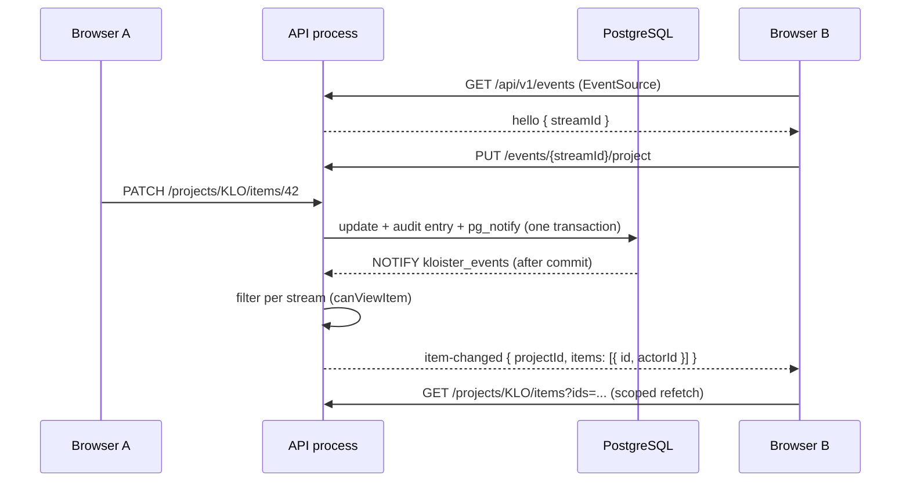

# Live updates and presence

Boards, backlogs, timelines, item details, My work and the notification bell update while people
look at them, and people see who else has an item open. This document describes the mechanism as
built in M10. The admin view (the switch, the httpd check) is in [ADMIN.md](../ADMIN.md#live-updates).

## Design

- **Events carry ids, never content.** A browser that hears about a change refetches it through
  the ordinary, scoped API. Content therefore follows exactly the same authorization as any other
  read.
- **Published from the audited write.** Every change already writes an audit entry in the
  same transaction as the change; that same call publishes the live message, so nothing changes without being
  announced and nothing is announced unless it committed.
- **PostgreSQL is the bus.** Messages travel on the database's own `LISTEN`/`NOTIFY` channel. No
  extra service, and nothing leaves the host.
- **Filtered per viewer.** The API decides for each open stream whether its owner may see the
  item, with the same rule as the API itself.

## Publishing

`AuditService.record()` calls `publishAudit()` (`apps/api/src/live/live-events.ts`), which maps the
audit action to a live kind through `AUDIT_LIVE_KIND`. That map is a complete record of every
`AuditAction`, so a new action does not compile until it is mapped or marked as not live.

| Kind      | Audit actions                                                                                                     | Message                                                                                        |
| --------- | ----------------------------------------------------------------------------------------------------------------- | ---------------------------------------------------------------------------------------------- |
| `item`    | Item created, updated, moved, deleted, trashed, restored; sprint followed; checklist, note and attachment changes | Item ids with their visibility facts after (and before, when the change can alter who sees it) |
| `links`   | Dependency added or removed                                                                                       | Both ends with their facts                                                                     |
| `board`   | Buckets, labels, sprints, holidays, trash purges                                                                  | Project id                                                                                     |
| `access`  | Members, teams, project settings, archive and unarchive                                                           | Project id                                                                                     |
| `session` | Sign-out, password changed or reset, user updated                                                                 | User ids whose streams must check their session                                                |
| `setting` | Settings updated with `meta.key = 'live'` (the admin switch)                                                      | None                                                                                           |
| not live  | Sign-in, account and admin actions, backups, exports, ADO transfers                                               | Nothing (ADO imports change items through the item actions)                                    |

The visibility facts are the item's creator, assignees, bucket and team: everything
`canViewItem` needs. A trashed item has no facts after the change, so viewers who saw it get
`item-removed`; a restore is an ordinary `item-changed` (M12). A cascade delete, and the trash or
restore of a batch of several items, becomes a project resync. A Story's followers each get their
own `SPRINT_FOLLOWED` entry, so every viewer hears only of the children they can see. A purge is a
`board` change, which open Trash pages reload on. Reordering a card inside its
bucket is not audited but is announced the same way, so other boards show the order.

`NotificationsService.notify()` publishes `notify` messages with the recipients' ids, in the
transaction that creates the notifications.

`sendLive()` runs `SELECT pg_notify('kloister_events', payload)` on the change's transaction
client; PostgreSQL delivers it only at commit, so refused or rolled-back changes are never
announced. Payloads above 7,000 bytes (PostgreSQL's limit is 8,000) become a project resync.

The acting browser tab sends a random id (`X-Client-Id`) with every request; the API keeps it for
the request (`live/client-id.ts`) and puts it in the message, so the stream of that tab skips its
own echo. The id steers echoes only and grants nothing.

## Listening and fan-out

- `PgListener` (`live/pg-listener.ts`) holds one dedicated PostgreSQL connection per API process
  running `LISTEN kloister_events`. It connects only while streams are open and closes 30 seconds
  after the last one, so the app and its tests run without it. After a lost connection it
  reconnects with backoff (1, 2, 5, 10, then 30 seconds) and sends every stream `resync`, because
  events may have been missed.
- `LiveHub` (`live/live-hub.ts`) keeps the open streams of its process. Messages arriving within
  50 ms (which includes every message of one transaction) are handled as one burst, so one change
  becomes one event per stream. Above 200 items in a burst, a project resync is sent instead.
- For each stream following the project, an item is sent only when `canViewItem` passes with the
  stream owner's current access for the facts after the change (`item-changed`), or failed after
  but passed before (`item-removed`, with `deleted: false` when the item only left the scope). A
  link is sent only when both ends are visible.
- `access` messages make streams on that project reload their access and send `access-changed`;
  the web app then reloads the project.
- My work: item events also reach a user's streams that follow another project when the user
  created or is assigned to the item, after the same visibility check.

## The stream

`GET /api/v1/events` (`live/live.controller.ts`) is a Server-Sent Events response
(`text/event-stream`, `Cache-Control: no-cache, no-transform`, `X-Accel-Buffering: no`). The tab's
client id travels as the `client` query parameter, since `EventSource` cannot send headers.

- It opens with `retry: 5000` and `hello` carrying the stream id, then a `: heartbeat` comment
  every 25 seconds.
- A user may hold 10 streams; opening an eleventh closes the oldest.
- The stream never extends the session (the route keeps the session idle). At every heartbeat the
  hub checks each stream's session and closes streams whose session ended or expired; sign-out,
  password changes and deactivation trigger the check at once through `session` messages.
- Control routes, both answering 204:
  - `PUT /api/v1/events/{streamId}/project` follows a project (by id or key) or none. Only members
    of the project (for a personal space, its owner) may follow it; anyone else, administrators on
    a cross-project visit included, gets 404.
  - `PUT /api/v1/events/{streamId}/work` follows another person's work (v1.4.0), so "all their work"
    refreshes live, or none (`null`). Only people the caller may look up for "all their work" (administrators
    anyone, others people who share an unarchived project with them); 404 otherwise. Their item changes reach
    the stream like the owner's own My work changes, still checked with the owner's access and visibility.
  - `PUT /api/v1/events/{streamId}/presence` reports what the tab is doing.
- `GET /api/v1/events/status` tells the web app whether to open a stream. With live updates
  switched off, `GET /events` answers 204, which browsers do not retry.

Events (data types are in `packages/shared/src/live.ts` and the [API reference](API.md#live-update-events)):

| Event            | Data                                               | Meaning                                                       |
| ---------------- | -------------------------------------------------- | ------------------------------------------------------------- |
| `hello`          | `{ streamId }`                                     | First event                                                   |
| `item-changed`   | `{ projectId, items: [{ id, actorId }] }`          | Visible items were created or changed                         |
| `item-removed`   | `{ projectId, items: [{ id, actorId, deleted }] }` | Items were deleted or left the viewer's scope                 |
| `links-changed`  | `{ projectId, ids }`                               | Links between visible items changed                           |
| `board-changed`  | `{ projectId }`                                    | Buckets, labels, sprints or holidays changed                  |
| `access-changed` | `{ projectId }`                                    | Members, roles, teams or settings changed; reload the project |
| `notification`   | `{}`                                               | The viewer received a notification                            |
| `presence`       | `{ projectId, people }`                            | Who else is on the project and what they are doing            |
| `project-resync` | `{ projectId }`                                    | Too much changed at once; reload the project                  |
| `resync`         | `{}`                                               | Events may have been missed; reload what is open              |
| `disabled`       | `{}`                                               | An administrator switched live updates off; the stream ends   |

## Presence

- A tab reports its project and, when relevant, the item it has open and what it is doing
  (`viewing`, `editing` a named field, `moving` a card or bar, `noting`), at most once a second.
- The hub publishes the entry on the same PostgreSQL channel, so every API process knows it. Each
  viewer receives only the people on the project whose item they can see; an entry on a hidden
  item shows the person without the item.
- Someone appears to others only after staying 2 seconds. An explicit leave or a closed tab removes
  the entry at once; entries from an API process that stopped confirming them expire after 60
  seconds.
- Presence is kept in memory only: never stored, audited or exported, and it cannot be hidden per
  person. Personal spaces have none.
- The control routes must reach the process that holds the stream; the supported deployment runs
  one API process.

## The web app

- `LiveService` (`apps/web/src/app/core/live.service.ts`) opens one `EventSource` per tab after
  sign-in, when the status route says live updates are on. It is loaded lazily with the other
  signed-in extras, so the first page stays small. It follows the open project, reports presence
  and keeps the connection status for the header chip: `connecting`, `live`, `reconnecting` after
  4 seconds without a stream, `offline` after a minute (or at once when the browser reports it is
  offline), `off` when switched off. Failed streams are retried after 2, 5, 10 and then 30
  seconds; after a reconnect the open project is reloaded once.
- `ProjectContext` (`core/project-context.ts`) gathers item events for 300 ms, then refetches the
  changed items through the scoped list (`GET .../items?ids=...`, up to 100 ids per request).
  Items no longer returned are gone for the viewer. Changed cards are highlighted briefly and show
  "Changed by … just now" for a minute. `board-changed`, `access-changed`, `project-resync` and
  `resync` reload the project.
- Nothing changes under a person's hands. A card or bar being dragged, or a timeline cell being
  edited, _holds_ its item: changes from others wait until the hold ends. The item drawer waits
  while focus is in a text field or editor, or a list, menu or date picker is open.
- When someone else changed the same thing meanwhile, a small dialog (`ui/conflict.ts`) names them
  and their role and offers **Keep mine** or **Use theirs**; closing it keeps the caller's change,
  so nothing typed is lost silently. No role outranks another. When two people move the same
  card, the later drop wins and the earlier mover's toast offers **Put back**.
- The notification count changes at once on `notification` events and its 60-second poll pauses
  while the stream is up. My work refetches quietly when the caller's items change.
- Reports and calendars (M13) need no new events. Share changes are ordinary `ITEM_UPDATED` entries.
  The project calendar draws from the project store, so it follows like the board; a drag holds its
  item and shows "moving" presence. An open report reloads when the store's items, sprints or links
  change (holiday and other project events reload the store), at most once every two seconds, and
  says "Updated just now" when its numbers changed. The My work calendar reloads on the caller's
  item events like the My work list.
- An administrator on a cross-project visit gets no live updates for that project; the page shows
  changes after a reload.

## The admin switch

Admin settings › General › **Live updates** (`AppSetting` key `live`, on by default). Switching it
off sends `disabled` to every stream and ends it; tabs then behave as before M10 and show changes
after a reload. Open tabs notice a later switch-on when they reload.

## httpd

The stream uses the existing `ProxyPass` for `/<app_name>/api/`; upgrades never change httpd
configuration. The response headers ask proxies not to buffer or compress it. If streaming arrives
late or in bursts, an operator adds one line with `flushpackets=on` before the general `ProxyPass`,
as described in [ADMIN.md](../ADMIN.md#live-updates).
