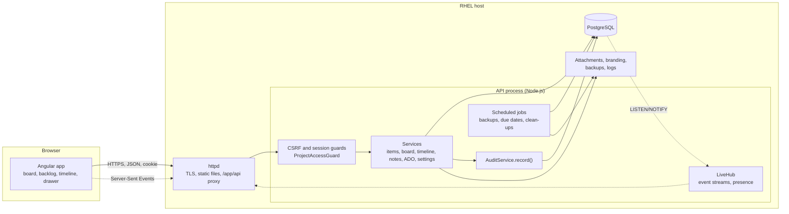
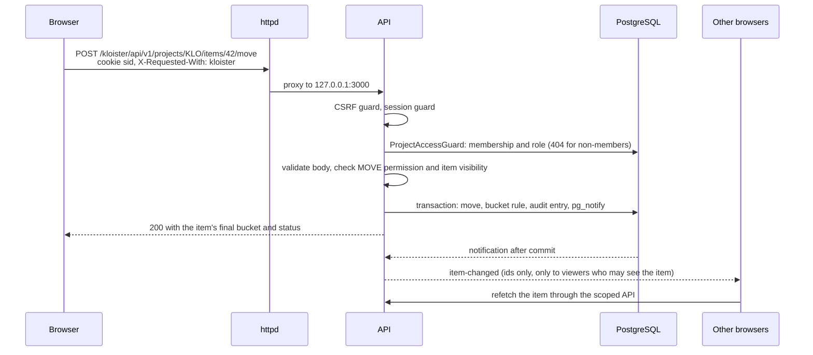

# Kloister technical overview

Kloister is a self-hosted Kanban and planning tool for one organization on one server. Technically
it is:

- a **NestJS** API on the Fastify adapter, written in TypeScript, with **Prisma** over
  **PostgreSQL** (`apps/api`);
- an **Angular** single-page app with Angular Material (`apps/web`);
- a shared package of types and pure logic used by both (`packages/shared`);
- Bash scripts that install and upgrade it on RHEL behind an existing **httpd** (`deploy`).

The server makes no outbound network calls: no email, webhooks, single sign-on or update checks.
Everything it needs is the database and a few folders on disk.

## Components

## Life of a request

Moving a card on the board:

## Design rules

- **Authorization lives in the API.** Guards and one `ProjectAccessService` decide every request;
  the web app only hides controls. ([SECURITY.md](SECURITY.md))
- **Hidden items answer 404.** Projects you are not in, and items outside your visibility scope,
  are indistinguishable from ones that do not exist. Every item query goes through one scoped
  filter; the few deliberate exceptions return no item content.
- **Audit everything.** Every change writes an append-only audit entry in the same transaction;
  that entry also drives item history and live updates.
- **Live updates carry ids, not content.** Browsers refetch through the normal API, so live updates
  never widen what anyone can see. ([LIVE-UPDATES.md](LIVE-UPDATES.md))
- **One source of rules.** Permission tables, DTOs and the scheduling planner live in
  `packages/shared`, so the API and the web app agree.
- **Additive changes.** Migrations after the first release only add; upgrades never change the
  firewall, SELinux or httpd beyond the one Kloister conf file.
- **No outbound calls.** The ADO transfer works with files a person carries.

## Documents

| Document                           | What it covers                                                                                                                            |
| ---------------------------------- | ----------------------------------------------------------------------------------------------------------------------------------------- |
| [ARCHITECTURE.md](ARCHITECTURE.md) | Repository layout, API modules, request pipeline, configuration, files, jobs, logging, backups, build and packaging, serving under a path |
| [SECURITY.md](SECURITY.md)         | Accounts, sessions, CSRF, roles, permissions, visibility scopes, teams, personal spaces, files, audit                                     |
| [DATA-MODEL.md](DATA-MODEL.md)     | Every table and enum, a generated diagram, settings JSON, migrations                                                                      |
| [SCHEDULING.md](SCHEDULING.md)     | Half days, working days and holidays, links and pins, the planner, rescheduling                                                           |
| [LIVE-UPDATES.md](LIVE-UPDATES.md) | Event publishing, LISTEN/NOTIFY, filtering, the stream, presence, the web client                                                          |
| [WEB.md](WEB.md)                   | Angular structure, routes, the project store, shared UI and theming, accessibility, bundle budget                                         |
| [ADO-TRANSFER.md](ADO-TRANSFER.md) | Internals of the CSV transfer with Azure DevOps                                                                                           |
| [API.md](API.md)                   | Every route, generated from the code, with permissions and schemas                                                                        |
| [TESTING.md](TESTING.md)           | Test layers, helpers, permission tests, CI                                                                                                |

Elsewhere:

- [SPEC.md](../../SPEC.md): the product specification and the source of truth for behaviour.
- [DESIGN.md](../DESIGN.md): the visual design.
- [DECISIONS.md](../DECISIONS.md): decisions made while building, by milestone.
- [INSTALL.md](../INSTALL.md), [UPGRADE.md](../UPGRADE.md), [ADMIN.md](../ADMIN.md): running a
  server.
- [CONTRIBUTING.md](../../CONTRIBUTING.md): setting up a development environment and the local
  gate.
- [`openapi.json`](../openapi.json): the machine-readable API description.
